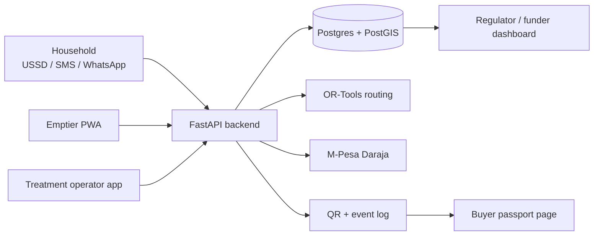

# PitFlow

**From pit to product, verified.**

PitFlow is a software platform that makes pit-latrine emptying in urban slums bookable, traceable and verifiable, then carries the treated sludge forward as a tracked, sellable product (compost, larvae feed, briquettes). One shared record, the **Batch**, links a household's "safely disposed" receipt to the buyer's product passport.


---

## The problem

In most informal settlements, pit emptying runs on phone calls, cash and guesswork.

- Households cannot find a trusted emptier or a fair price.
- Emptiers run half-empty routes and have no demand data.
- Much sludge is dumped in drains and rivers because the legal site is far and nobody checks.
- Treatment and composting projects struggle to get paid because no one can verify safe handling.
- Regulators and funders see none of it.

## The solution

PitFlow connects the whole chain on one platform and works over **USSD and SMS**, so it needs no smartphone and no new hardware.

| Stage | Module | What happens |
|---|---|---|
| 1. Request | Dispatch | Household requests emptying by USSD, SMS or WhatsApp and gets a price quote |
| 2. Dispatch | Dispatch | Nearby jobs are bundled and routed to an emptier |
| 3. Drop-off | **PitStop** | GPS trace ends at an approved site; operator scans a QR to check in the load |
| 4. Batching | Bridge | Verified loads are grouped into a treatment batch |
| 5. Treatment | Ledger | Operator logs duration and temperature; rules check compliance |
| 6. Product | Ledger | Compliant batch becomes a product with a QR passport |
| 7. Sale and reporting | Ledger | Buyer scans the passport; funders get an auditable impact report |

## Modules

- **PitFlow Dispatch**: booking, route batching, emptier app, GPS trace, household receipts.
- **PitStop**: the verification moment. A QR check-in at an approved treatment or transfer site closes the loop for each load.
- **PitFlow Ledger**: batch chain of custody, treatment-compliance rules, product passports, impact reports.

## Architecture



**Core data model:** `Household → Job → Trip → Load → Batch → TreatmentLog → Product → Sale`

**Tamper evidence:** each event in the log stores a hash of the previous event, so any edit to history is detectable. No blockchain required.

## Tech stack

| Layer | Tools |
|---|---|
| Backend | Python, FastAPI |
| Database | PostgreSQL, PostGIS |
| Routing | Google OR-Tools |
| Messaging | Africa's Talking (USSD, SMS), WhatsApp Cloud API |
| Payments | M-Pesa Daraja (sandbox) |
| Frontend | React or PWA, MapLibre |
| Traceability | QR generation and scanning, hash-chained event log |
| Rules | Configurable compliance rules (for example, minimum days above a temperature) |

## Smart features (without unnecessary AI)

- Route optimisation that bundles nearby jobs into efficient trips
- Rules-based treatment compliance checks
- Tamper-evident record chain
- Anomaly flag when a trip ends away from an approved site

## Getting started

```bash
git clone https://github.com/<your-username>/pitflow.git
cd pitflow

# Start database and services
docker compose up -d

# Backend
cd backend
python -m venv .venv && source .venv/bin/activate
pip install -r requirements.txt
cp .env.example .env        # add sandbox keys for Africa's Talking and Daraja
uvicorn app.main:app --reload

# Load simulated demo data
python scripts/seed_demo.py
```

## Repository structure

```
pitflow/
├── backend/          # FastAPI app, routing, rules engine, event log
├── apps/
│   ├── emptier-pwa/  # Emptier job and check-in app
│   └── dashboard/    # Regulator and funder dashboard
├── scripts/          # Seed and demo data
├── docs/             # Architecture diagrams, cost estimate, canvas
└── docker-compose.yml
```

## Demo

The demo walks the full chain in about three minutes:

1. A USSD request arrives and a quote is returned.
2. Three nearby jobs are bundled into one route.
3. The emptier scans the PitStop QR; the household receives an SMS receipt.
4. The operator logs treatment readings and the rules engine marks the batch compliant.
5. A product QR is generated and scanning it shows the chain from pit to product.
6. The funder dashboard shows tonnes treated, safe-disposal rate and product sold.

**Data note:** all demo data is simulated and labelled as such. Map layers use open data (OpenStreetMap).


## Business model

- **Emptiers:** small booking fee per job
- **Treatment operators:** per-batch or subscription fee for compliance and passport tools
- **Funders and county governments:** paid access to verified data and reports
- **Product buyers:** pay for product; the passport supports better pricing

## Roadmap

- [ ] Booking flow over USSD sandbox
- [ ] Route bundling with OR-Tools
- [ ] PitStop QR check-in and household receipt
- [ ] Batch record and compliance rules
- [ ] Product passport page
- [ ] Funder dashboard and impact report
- [ ] Pilot with one emptier group and one treatment site

## Limitations

- Treatment readings are entered by people, so the design relies on the tamper-evident log and audit sampling.
- A real pilot needs access to an approved treatment site and an emptier group.
- Current stage: ideation with a working software prototype, not piloted.


## License

MIT. See `LICENSE`.
